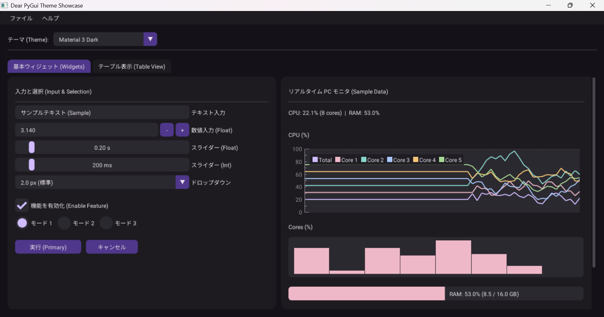
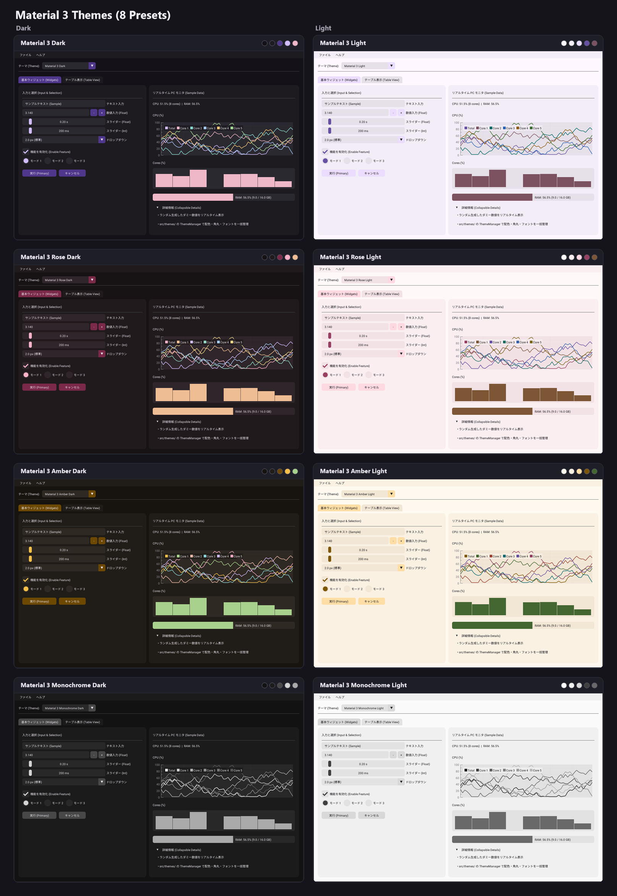

# Dear PyGui Theme Showcase

Dear PyGui 向けの **Material 3** カスタムテーマです。

## 特徴
- **Material 3 カラーパレット（全 8 種）**: Baseline（Purple）/ Rose / Amber / Monochrome の各 Dark・Light テーマを収録
- **日英ハイブリッドフォント同梱**: `Roboto`（欧文）＋ `Noto Sans JP`（和文）の合成フォントを `ThemeManager` で一括適用
- **最小依存**: 外部パッケージは `dearpygui` のみ（グラフ更新も標準ライブラリのランダム生成によるダミーデータで動作）

## 収録テーマ（全 8 種）



## 起動方法

```bash
uv sync
uv run src/main.py
```

## ファイル構成
- `src/main.py`: アプリのエントリーポイント（Viewport・メインループ）
- `src/ui/`: UI コンポーネントパッケージ
  - `__init__.py`: UI ビルダー・`LiveMonitor` の公開エクスポート
  - `chrome.py`: メニューバー・テーマ切り替えヘッダー・バージョン情報モーダル
  - `panels.py`: 左カラム（入力と選択）・テーブル表示タブ
  - `monitor.py`: `LiveMonitor` クラス（ダミーリアルタイムグラフの構築と更新）
- `src/themes/`: Material 3 テーマ管理パッケージ
  - `__init__.py`: `ThemeManager` などの公開エクスポート
  - `palettes.py`: Material 3 カラーパレット・プロット用カラーマップ定義
  - `manager.py`: `ThemeManager` クラス・スタイル適用・フォント読み込み
- `fonts/RobotoNotoJP-Regular.ttf`: 日英混在表示用フォント
